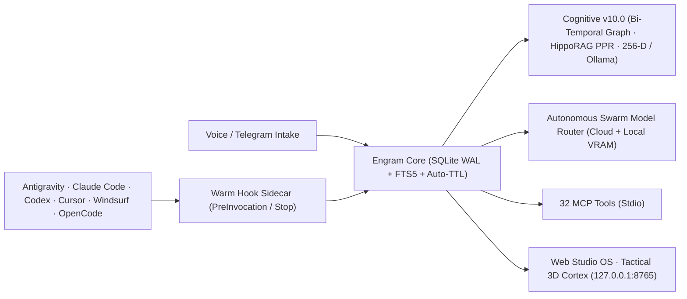

<div align="center">

# 🧠 Engram

**Universal AI Memory, Bi-Temporal Knowledge Graph & Autonomous Swarm OS**

[](docs/CHANGELOG.md)
[](requirements.txt)
[](docs/ARCHITECTURE.md)
[](docs/API_AND_MCP.md)
[](test_brain.py)
[](docs/MULTI_PLATFORM_SWARM.md)

*Every fact sourced · One shared memory across every AI IDE & agent · Bi-temporal recall · Zero external cloud dependencies.*

[Architecture](docs/ARCHITECTURE.md) · [Cognitive v10.0](docs/COGNITIVE_V10.md) · [Multi-IDE & Swarm](docs/MULTI_PLATFORM_SWARM.md) · [Studio UI](docs/STUDIO_UI.md) · [API & 32 MCP Tools](docs/API_AND_MCP.md) · [Changelog](docs/CHANGELOG.md)

</div>

---

## What is Engram?

**Engram** is a local-first, zero-dependency cognitive memory layer and agent orchestrator built on **SQLite WAL + FTS5 BM25 + Local Neural Embeddings + Personalized PageRank (HippoRAG)**. It injects relevant project context *before* your AI replies (via native `PreInvocation` / `UserPromptSubmit` hooks) and automatically harvests architectural decisions, bug fixes, and recurring user corrections *after* each turn (`Stop` hook) — at **zero extra LLM tool-call cost**.



---

## Key Capabilities

| Pillar | What It Does | Deep Dive |
|---|---|---|
| **Local Neural Cortex (v11.0)** | 4-layer local neural stack: **ONNX Multilingual Bi-Encoder** (`paraphrase-multilingual-MiniLM-L12-v2`) + **`sqlite-vec` C SIMD** + **Cross-Encoder Reranker** + **Personal Online NumPy MLP** (`12→24→12→1`) + **Intent & Correction Heads**. | [Cognitive & Neural →](docs/COGNITIVE_V10.md) |
| **Bi-Temporal Graph & HippoRAG (v10.0)** | Tracks `valid_from` / `valid_to` / `SUPERSEDES` with point-in-time `as_of` Time-Travel, **2-hop Personalized PageRank**, and offline **256-D / Ollama** embeddings. | [Cognitive & Neural →](docs/COGNITIVE_V10.md) |
| **Warm Hook Sidecar & DB Auto-TTL (v9.2)** | In-process warm HTTP hook fast-path, zero-WMI OS detection, automatic retention pruning (`VACUUM`), collision-safe file harvesting, and Windows **DPAPI** secret encryption. | [Architecture →](docs/ARCHITECTURE.md) |
| **7-IDE Bridge & Autonomous Router** | Detects active IDE, OS, cloud model & local LLMs (`Ollama`, `LM Studio`, `vLLM`, `llama.cpp`), dynamically routes Swarm lanes under 5h quota pressure, and exports `HANDOFF.md`. | [Multi-IDE & Swarm →](docs/MULTI_PLATFORM_SWARM.md) |
| **Nightly Rules & Telegram/Voice Intake** | Distills recurring session corrections into canonical `AGENTS.md` rules automatically and routes voice/Telegram notes directly into Markdown Vault dossiers or Kanban tasks. | [Multi-IDE & Swarm →](docs/MULTI_PLATFORM_SWARM.md) |
| **Amber Tactical 3D Studio OS** | Interactive **60 FPS Free-Flight 3D Neural Constellation** (`WASD+QE`, infinite pan, fly-through scroll, 6 live telemetry widgets) + 6 dedicated engineering studios. | [Studio UI →](docs/STUDIO_UI.md) |
| **32 MCP Tools & REST API** | Complete Stdio MCP server + local HTTP API covering memory, AST symbol lookup, blast radius, Graphify BFS, Archify delta, Pagoda folds, HippoRAG, and DB hygiene. | [API & MCP Reference →](docs/API_AND_MCP.md) |

---

## Quick Start

Requires **Python 3.10+** (standard library only — zero `pip install` needed).

```bash
# 1. Clone the repository
git clone https://github.com/Miguel-Reis/engram.git
cd engram

# 2. Install hooks, MCP server, and start the local Web Studio OS
python install.py --targets antigravity

# 3. Verify all 37 automated test suites
python test_brain.py
```

Open the live dashboard at **[http://127.0.0.1:8765](http://127.0.0.1:8765)**.

### Connect Additional IDEs & CLIs

```bash
# Connect all detected IDEs/CLIs (Antigravity, Claude Code, Codex CLI, Cursor, Windsurf, OpenCode, Claude Desktop)
python install.py --targets all

# Or target specific clients
python install.py --targets claude_code,cursor,codex_cli
```

---

## Documentation Hub

| Document | Contents |
|---|---|
| **[docs/ARCHITECTURE.md](docs/ARCHITECTURE.md)** | Zero-Round-Trip hook lifecycle, Warm Hook Fast-Path, SQLite WAL schema & Auto-TTL hygiene, Pagoda LSM lossless folding, Archify Evidence Console, Graphify AST BFS, and DPAPI/CSRF security. |
| **[docs/COGNITIVE_V10.md](docs/COGNITIVE_V10.md)** | Bi-Temporal Knowledge Graph (`SUPERSEDES` & `as_of` Time-Travel), HippoRAG Personalized PageRank multi-hop retrieval, Local Neural Embeddings (`Ollama` / `sqlite-vec` / 256-D bilingual fallback), GBrain axes & Skill Resolver. |
| **[docs/MULTI_PLATFORM_SWARM.md](docs/MULTI_PLATFORM_SWARM.md)** | 7-IDE Cross-OS Bridge, Cloud + Local LLM VRAM probing, Autonomous Swarm Model Router, Nightly Correction ➔ Rule Distiller, Telegram/Voice Intake, and Cross-IDE `HANDOFF.md`. |
| **[docs/STUDIO_UI.md](docs/STUDIO_UI.md)** | All 7 Web Studios (`01 Córtex` Tactical 3D Free-Flight + 6 widgets, `02 Swarm`, `03 Office 3D`, `04 Self-Learn`, `05 Prompt Forge`, `06 Vault 6x`, `07 Tasks`) + Inspector Labs & keyboard shortcuts. |
| **[docs/API_AND_MCP.md](docs/API_AND_MCP.md)** | Full specification of all **32 MCP tools** and local REST API endpoints. |
| **[docs/CHANGELOG.md](docs/CHANGELOG.md)** | Release notes from `v10.0` back to `v2.0`. |

---

## Repository Layout

```text
engram/
├── brain_inject.py           # PreInvocation / UserPromptSubmit hook + Warm HTTP Fast-Path
├── brain_harvest.py          # Stop hook + collision-safe file harvest + correction signal capture
├── db_engine.py              # SQLite WAL, FTS5 BM25, LSH 128-D, Auto-TTL & VACUUM maintenance
├── cognitive_v10_engine.py   # Bi-Temporal Graph, HippoRAG PPR Multi-Hop & Local Neural Embeddings
├── neural_cortex_engine.py   # v11.0 4-Layer Neural Cortex (ONNX, sqlite-vec, Personal NumPy MLP, Intent/Correction)
├── runtime_detector.py       # Zero-WMI OS/IDE/Cloud/Local VRAM detection & Swarm Model Router
├── rule_distiller_engine.py  # Nightly Correction -> Canonical Rule Distiller
├── intake_handoff_engine.py  # DPAPI Telegram/Voice Intake + Cross-IDE HANDOFF.md exporter
├── swarm_engine.py           # Scout-First Asymmetric Swarm, AST Lookup, CoW Sandboxes & Office 3D
├── orbit_engine.py           # Vault Dossiers, Self-Learn Sentinel, Prompt Forge, DOTS DAG & 7-IDE Bridge
├── graphify_engine.py        # Multi-Modal Knowledge Graph, God Nodes & BFS Shortest Path
├── archify_engine.py         # Zero-Token Architecture Delta, Reachability & Portable HTML Export
├── pagoda_fold_engine.py     # Lossless Multi-Tier zlib Episode Folding
├── skill_resolver_engine.py  # <1ms Local SKILL.md Indexer across installed plugins
├── voice_brain_engine.py     # STT Denoiser, Phonetic AST Resolver & Zero-Call Pre-Executor
├── web_dashboard.py          # Local HTTP/SSE Server + Warm Hook Sidecar (127.0.0.1:8765)
├── server.py                 # Stdio MCP Server (32 tools, zero external deps)
├── index.html                # Web Studio OS (Amber Tactical 3D Córtex + 7 Studios)
├── install.py                # Cross-OS Installer (Windows / macOS / Linux)
├── test_brain.py             # 37 End-to-End Test Suites
└── docs/                     # Modular Documentation Hub
```
